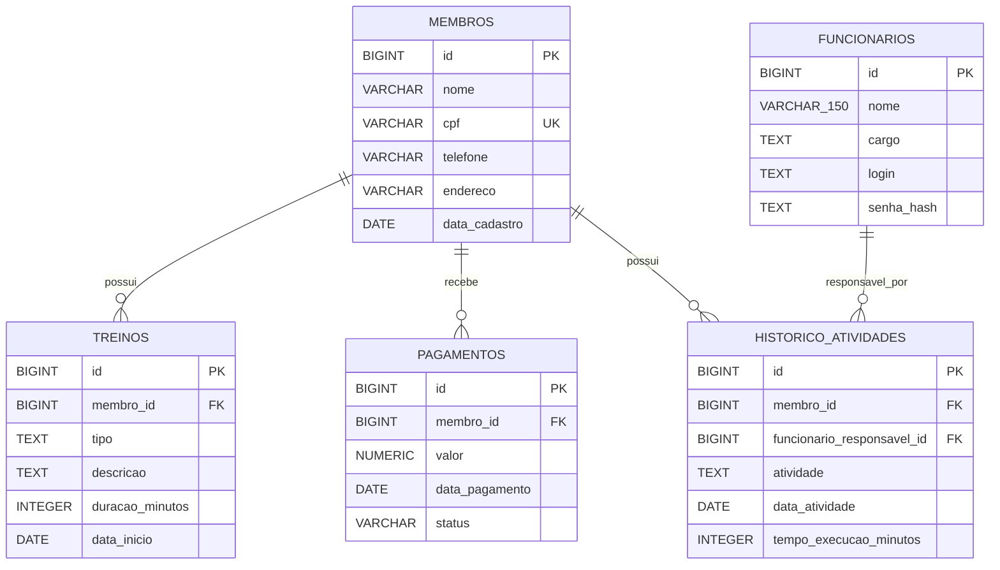

# Modelo de Dados — VIGOR

## 1. Objetivo e situação

Este documento descreve o schema PostgreSQL do VIGOR, suas entidades, relacionamentos e restrições, distinguindo o que está registrado nas migrations do que já possui mapeamento no código Java.

O banco local foi atualizado e conferido conforme confirmação da equipe: contém as tabelas `membros`, `funcionarios`, `treinos`, `pagamentos` e `historico_atividades`. As migrations V1 a V5 são a referência versionada da estrutura. Não foi realizada consulta direta ao PostgreSQL nesta atualização documental.

## 2. Tabelas

### 2.1. `membros` — V1

| Coluna | Tipo | Obrigatória | Chave / restrição |
|---|---|---:|---|
| `id` | `BIGINT GENERATED BY DEFAULT AS IDENTITY` | Sim | Chave primária. |
| `nome` | `VARCHAR(150)` | Sim | — |
| `cpf` | `VARCHAR(11)` | Sim | `uk_membros_cpf` — valor único. |
| `telefone` | `VARCHAR(20)` | Sim | — |
| `endereco` | `VARCHAR(255)` | Sim | — |
| `data_cadastro` | `DATE` | Sim | — |

A V1 impõe `NOT NULL` aos campos da tabela e unicidade ao CPF. Não possui `CHECK` para validar conteúdo não vazio, formato do CPF ou seus dígitos verificadores; essas validações pertencem à aplicação. As regras de negócio exigem normalização, validação dos dígitos, rejeição de sequências repetidas e CPF único (RN01–RN04).

### 2.2. `funcionarios` — V2

| Coluna | Tipo | Obrigatória | Chave / restrição |
|---|---|---:|---|
| `id` | `BIGINT GENERATED BY DEFAULT AS IDENTITY` | Sim | Chave primária. |
| `nome` | `VARCHAR(150)` | Sim | `ck_funcionarios_nome_nao_vazio`: `btrim(nome) <> ''`. |
| `cargo` | `TEXT` | Sim | `ck_funcionarios_cargo_nao_vazio`: `btrim(cargo) <> ''`. |
| `login` | `TEXT` | Sim | `ck_funcionarios_login_nao_vazio`: `btrim(login) <> ''`. |
| `senha_hash` | `TEXT` | Sim | `ck_funcionarios_senha_hash_nao_vazio`: `btrim(senha_hash) <> ''`. |

O índice único `ux_funcionarios_login_normalizado` aplica `lower(btrim(login))`, tornando equivalentes logins que diferem por caixa ou por espaços comuns nas extremidades. O fluxo de autenticação deve usar normalização equivalente. A comparação de caixa segue as regras de localidade do banco.

O schema não cria funcionários nem implementa tela de cadastro. Funcionários são previamente disponibilizados por procedimento técnico (RF01, RN18–RN20). A coluna e o `CHECK` garantem obrigatoriedade e conteúdo não vazio; não verificam que o valor esteja codificado como BCrypt. A aplicação deve gerar e verificar hashes BCrypt, sem persistir senhas em texto puro (RN18, RNF01).

### 2.3. `treinos` — V3

| Coluna | Tipo | Obrigatória | Chave / restrição |
|---|---|---:|---|
| `id` | `BIGINT GENERATED BY DEFAULT AS IDENTITY` | Sim | Chave primária. |
| `membro_id` | `BIGINT` | Sim | FK `fk_treinos_membros` para `membros(id)`, `ON DELETE RESTRICT`. |
| `tipo` | `TEXT` | Sim | `ck_treinos_tipo_nao_vazio`: `btrim(tipo) <> ''`. |
| `descricao` | `TEXT` | Sim | `ck_treinos_descricao_nao_vazia`: `btrim(descricao) <> ''`. |
| `duracao_minutos` | `INTEGER` | Sim | `ck_treinos_duracao_positiva`: valor maior que zero. |
| `data_inicio` | `DATE` | Sim | — |

O índice `idx_treinos_membro_id` atende consultas pelo membro. Cada treino deve pertencer a um membro existente; um membro pode ter zero ou vários treinos (RN07–RN09). As operações previstas são cadastro e consulta (RF06–RF07).

### 2.4. `pagamentos` — V4

| Coluna | Tipo | Obrigatória | Chave / restrição |
|---|---|---:|---|
| `id` | `BIGINT GENERATED BY DEFAULT AS IDENTITY` | Sim | Chave primária. |
| `membro_id` | `BIGINT` | Sim | FK `fk_pagamentos_membros` para `membros(id)`, `ON DELETE RESTRICT`. |
| `valor` | `NUMERIC(12,2)` | Sim | `ck_pagamentos_valor_positivo`: valor maior que zero. |
| `data_pagamento` | `DATE` | Sim | — |
| `status` | `VARCHAR(4)` | Sim | `ck_pagamentos_status_pago`: valor exclusivamente `PAGO`. |

O índice `idx_pagamentos_membro_id` atende consultas pelo membro. Cada pagamento pertence a um membro existente; um membro pode ter zero ou vários pagamentos (RN10–RN13). O schema registra pagamentos recebidos com status `PAGO`; não inclui contas a receber ou pagamentos pendentes (RF08, RN13). A aplicação continua responsável por rejeitar valores informados com mais de duas casas decimais, conforme RN12.

### 2.5. `historico_atividades` — V5

| Coluna | Tipo | Obrigatória | Chave / restrição |
|---|---|---:|---|
| `id` | `BIGINT GENERATED BY DEFAULT AS IDENTITY` | Sim | Chave primária. |
| `membro_id` | `BIGINT` | Sim | FK `fk_historico_atividades_membros` para `membros(id)`, `ON DELETE RESTRICT`. |
| `funcionario_responsavel_id` | `BIGINT` | Sim | FK `fk_historico_atividades_funcionarios` para `funcionarios(id)`, `ON DELETE RESTRICT`. |
| `atividade` | `TEXT` | Sim | `ck_historico_atividades_atividade_nao_vazia`: `btrim(atividade) <> ''`. |
| `data_atividade` | `DATE` | Sim | — |
| `tempo_execucao_minutos` | `INTEGER` | Sim | `ck_historico_atividades_tempo_positivo`: valor maior que zero. |

O índice `idx_historico_atividades_membro_id` atende consultas pelo membro. Cada atividade referencia exatamente um membro existente e um funcionário responsável existente; cada um pode estar associado a zero ou vários registros de atividade. O requisito de funcionário responsável está materializado pela coluna e FK da V5 (RN14–RN16). Os registros serão disponibilizados por carga técnica documentada, sem tela para criação manual; a consulta permanece no escopo (RF09, RN17, CA13–CA14 e CA22).

## 3. Relacionamentos e integridade referencial

| Origem | Destino | Cardinalidade | Ação ao excluir o registro referenciado |
|---|---|---|---|
| `treinos.membro_id` | `membros.id` | Um membro para zero ou muitos treinos; cada treino para um membro (1:N). | `ON DELETE RESTRICT`. |
| `pagamentos.membro_id` | `membros.id` | Um membro para zero ou muitos pagamentos; cada pagamento para um membro (1:N). | `ON DELETE RESTRICT`. |
| `historico_atividades.membro_id` | `membros.id` | Um membro para zero ou muitas atividades; cada atividade para um membro (1:N). | `ON DELETE RESTRICT`. |
| `historico_atividades.funcionario_responsavel_id` | `funcionarios.id` | Um funcionário para zero ou muitas atividades; cada atividade para um funcionário (1:N). | `ON DELETE RESTRICT`. |

As quatro FKs e suas ações referenciais estão definidas nas migrations. Assim, referências inexistentes são rejeitadas e exclusões dos registros referenciados são bloqueadas enquanto houver dependentes. Em particular, não há exclusão em cascata de treinos, pagamentos ou histórico. O bloqueio de exclusão de membros com vínculos também é exigido por RN06, RF05, CA08 e CA19.

## 4. Restrições e índices registrados

- **Chaves primárias:** `id` em cada uma das cinco tabelas, gerado como `BIGINT IDENTITY BY DEFAULT`.
- **Unicidade:** `uk_membros_cpf` em `membros(cpf)`; índice único funcional `ux_funcionarios_login_normalizado` em `funcionarios(lower(btrim(login)))`.
- **Obrigatoriedade:** todas as colunas listadas nas migrations são `NOT NULL`.
- **Campos textuais não vazios:** checks de `funcionarios.nome`, `cargo`, `login` e `senha_hash`; `treinos.tipo` e `descricao`; `historico_atividades.atividade`. A V1 de membros não define esses checks.
- **Valores numéricos:** duração do treino e tempo da atividade devem ser maiores que zero; valor do pagamento deve ser maior que zero.
- **Status:** pagamentos aceitam somente `PAGO`.
- **Índices para consulta por membro:** `idx_treinos_membro_id`, `idx_pagamentos_membro_id` e `idx_historico_atividades_membro_id`.
- **Referências:** as FKs listadas na seção 3 usam `ON DELETE RESTRICT`.

Os checks `btrim(campo) <> ''` removem espaços comuns no início e no fim para essa verificação. Eles não substituem validações de aplicação para os demais caracteres de espaço, validação de CPF ou geração de BCrypt. A coluna `NUMERIC(12,2)` define precisão e escala para pagamentos; a validação da entrada conforme RN12 deve ocorrer antes da persistência.

## 5. Diagrama ER do schema

O diagrama abaixo representa as cinco tabelas e os quatro relacionamentos definidos nas migrations V1–V5. `||` indica exatamente um registro referenciado e `o{` indica zero ou muitos dependentes.

O índice de login é único sobre a expressão normalizada; não é uma constraint `UNIQUE` simples sobre o texto armazenado.

## 6. Implementação e escopo funcional

Segundo a confirmação da equipe, o banco contém as cinco tabelas descritas, correspondentes às migrations V1–V5. No código Java consultado, `Membro` é a única entidade JPA; `MembroRepository` e `MembroService` também são específicos de membros. Entidades, repositórios e associações JPA para Funcionário, Treino, Pagamento e Histórico de Atividades ainda não foram encontrados.

As cinco entidades fazem parte do escopo final. Funcionários são previamente cadastrados por procedimento técnico, sem tela de cadastro; o histórico é disponibilizado por carga técnica, sem tela de registro manual. A existência das tabelas no banco não significa que todos os fluxos da aplicação estejam implementados.

## 7. Pendências de implementação

- Implementar mapeamentos JPA, repositórios, serviços e fluxos de aplicação ainda ausentes para Funcionários, Treinos, Pagamentos e Histórico de Atividades.
- Implementar autenticação com BCrypt e garantir que a consulta de login aplique normalização equivalente a `lower(btrim(login))`.
- Implementar validações da aplicação que complementam os checks do banco, incluindo CPF e rejeição da entrada monetária com mais de duas casas decimais.
- Definir e documentar os procedimentos técnicos seguros para disponibilizar os funcionários e carregar registros iniciais do histórico.
- Criar testes de integração que verifiquem os relacionamentos, constraints e comportamento de exclusão no PostgreSQL.

As tabelas, tipos, constraints, índices, relacionamentos e ações referenciais descritos neste documento estão definidos nas migrations existentes; as pendências acima dizem respeito à implementação e verificação da aplicação.

## Referências

- [Requisitos](../../requirements/requisitos.md)
- [Regras de negócio](../../requirements/regras-de-negocio.md)
- [Critérios de aceitação](../../requirements/criterios-de-aceite.md)
- [Relacionamentos](relacionamentos.md)
- [Estratégia de migrations](migrations.md)
- [Ambientes de banco](ambientes.md)
- [Decisões técnicas](../decisoes.md)
- [V1 — membros](../../../src/main/resources/db/migration/V1__cria_tabela_membros.sql)
- [V2 — funcionários](../../../src/main/resources/db/migration/V2__cria_funcionarios.sql)
- [V3 — treinos](../../../src/main/resources/db/migration/V3__cria_treinos.sql)
- [V4 — pagamentos](../../../src/main/resources/db/migration/V4__cria_pagamentos.sql)
- [V5 — histórico de atividades](../../../src/main/resources/db/migration/V5__cria_historico_atividades.sql)
