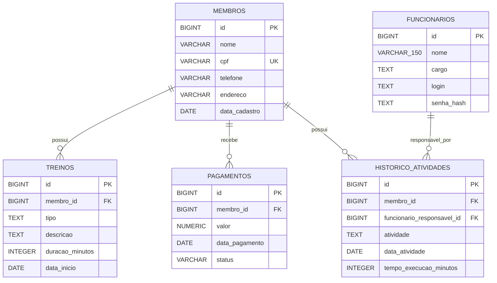

# Modelo de Dados — VIGOR

## 1. Objetivo e situação

Este documento descreve o schema PostgreSQL do VIGOR, suas entidades, relacionamentos e restrições, distinguindo o que está registrado nas migrations do que já possui mapeamento no código Java.

O banco local foi atualizado e conferido conforme confirmação da equipe: contém as tabelas `membros`, `funcionarios`, `treinos`, `pagamentos` e `historico_atividades`. As migrations V1 a V5 são a referência versionada da estrutura. Não foi realizada consulta direta ao PostgreSQL nesta atualização documental.

## 2. Tabelas

### 2.1. `membros` — V1

| Coluna | Tipo | Obrigatória | Chave / restrição |
|---|---|---:|---|
| `id` | `BIGINT GENERATED BY DEFAULT AS IDENTITY` | Sim | Chave primária. |
| `nome` | `VARCHAR(150)` | Sim | — |
| `cpf` | `VARCHAR(11)` | Sim | `uk_membros_cpf` — valor único. |
| `telefone` | `VARCHAR(20)` | Sim | — |
| `endereco` | `VARCHAR(255)` | Sim | — |
| `data_cadastro` | `DATE` | Sim | — |

A V1 impõe `NOT NULL` aos campos da tabela e unicidade ao CPF. Não possui `CHECK` para validar conteúdo não vazio, formato do CPF ou seus dígitos verificadores; essas validações pertencem à aplicação. As regras de negócio exigem normalização, validação dos dígitos, rejeição de sequências repetidas e CPF único (RN01–RN04).

### 2.2. `funcionarios` — V2

| Coluna | Tipo | Obrigatória | Chave / restrição |
|---|---|---:|---|
| `id` | `BIGINT GENERATED BY DEFAULT AS IDENTITY` | Sim | Chave primária. |
| `nome` | `VARCHAR(150)` | Sim | `ck_funcionarios_nome_nao_vazio`: `btrim(nome) <> ''`. |
| `cargo` | `TEXT` | Sim | `ck_funcionarios_cargo_nao_vazio`: `btrim(cargo) <> ''`. |
| `login` | `TEXT` | Sim | `ck_funcionarios_login_nao_vazio`: `btrim(login) <> ''`. |
| `senha_hash` | `TEXT` | Sim | `ck_funcionarios_senha_hash_nao_vazio`: `btrim(senha_hash) <> ''`. |

O índice único `ux_funcionarios_login_normalizado` aplica `lower(btrim(login))`, tornando equivalentes logins que diferem por caixa ou por espaços comuns nas extremidades. O fluxo de autenticação deve usar normalização equivalente. A comparação de caixa segue as regras de localidade do banco.

O schema não cria funcionários nem implementa tela de cadastro. Funcionários são previamente disponibilizados por procedimento técnico (RF01, RN18–RN20). A coluna e o `CHECK` garantem obrigatoriedade e conteúdo não vazio; não verificam que o valor esteja codificado como BCrypt. No código atual, `FuncionarioSecurityConfiguration` fornece um `BCryptPasswordEncoder` e `FuncionarioService` usa `matches` na autenticação. Não existe, neste serviço, uma operação de inclusão que gere e persista o hash; o procedimento técnico de provisionamento deve gravar um hash BCrypt, nunca a senha em texto puro (RN18, RNF01).

### 2.3. `treinos` — V3

| Coluna | Tipo | Obrigatória | Chave / restrição |
|---|---|---:|---|
| `id` | `BIGINT GENERATED BY DEFAULT AS IDENTITY` | Sim | Chave primária. |
| `membro_id` | `BIGINT` | Sim | FK `fk_treinos_membros` para `membros(id)`, `ON DELETE RESTRICT`. |
| `tipo` | `TEXT` | Sim | `ck_treinos_tipo_nao_vazio`: `btrim(tipo) <> ''`. |
| `descricao` | `TEXT` | Sim | `ck_treinos_descricao_nao_vazia`: `btrim(descricao) <> ''`. |
| `duracao_minutos` | `INTEGER` | Sim | `ck_treinos_duracao_positiva`: valor maior que zero. |
| `data_inicio` | `DATE` | Sim | — |

O índice `idx_treinos_membro_id` atende consultas pelo membro. Cada treino deve pertencer a um membro existente; um membro pode ter zero ou vários treinos (RN07–RN09). As operações previstas são cadastro e consulta (RF06–RF07).

### 2.4. `pagamentos` — V4

| Coluna | Tipo | Obrigatória | Chave / restrição |
|---|---|---:|---|
| `id` | `BIGINT GENERATED BY DEFAULT AS IDENTITY` | Sim | Chave primária. |
| `membro_id` | `BIGINT` | Sim | FK `fk_pagamentos_membros` para `membros(id)`, `ON DELETE RESTRICT`. |
| `valor` | `NUMERIC(12,2)` | Sim | `ck_pagamentos_valor_positivo`: valor maior que zero. |
| `data_pagamento` | `DATE` | Sim | — |
| `status` | `VARCHAR(4)` | Sim | `ck_pagamentos_status_pago`: valor exclusivamente `PAGO`. |

O índice `idx_pagamentos_membro_id` atende consultas pelo membro. Cada pagamento pertence a um membro existente; um membro pode ter zero ou vários pagamentos (RN10–RN13). O schema registra pagamentos recebidos com status `PAGO`; não inclui contas a receber ou pagamentos pendentes (RF08, RN13). A aplicação continua responsável por rejeitar valores informados com mais de duas casas decimais, conforme RN12.

### 2.5. `historico_atividades` — V5

| Coluna | Tipo | Obrigatória | Chave / restrição |
|---|---|---:|---|
| `id` | `BIGINT GENERATED BY DEFAULT AS IDENTITY` | Sim | Chave primária. |
| `membro_id` | `BIGINT` | Sim | FK `fk_historico_atividades_membros` para `membros(id)`, `ON DELETE RESTRICT`. |
| `funcionario_responsavel_id` | `BIGINT` | Sim | FK `fk_historico_atividades_funcionarios` para `funcionarios(id)`, `ON DELETE RESTRICT`. |
| `atividade` | `TEXT` | Sim | `ck_historico_atividades_atividade_nao_vazia`: `btrim(atividade) <> ''`. |
| `data_atividade` | `DATE` | Sim | — |
| `tempo_execucao_minutos` | `INTEGER` | Sim | `ck_historico_atividades_tempo_positivo`: valor maior que zero. |

O índice `idx_historico_atividades_membro_id` atende consultas pelo membro. Cada atividade referencia exatamente um membro existente e um funcionário responsável existente; cada um pode estar associado a zero ou vários registros de atividade. O requisito de funcionário responsável está materializado pela coluna e FK da V5 (RN14–RN16). `HistoricoAtividadeService` permite registrar e consultar atividades; não há tela para criação manual, e o serviço não substitui um fluxo web (RF09, RN17, CA13–CA14 e CA22).

## 3. Relacionamentos e integridade referencial

| Origem | Destino | Cardinalidade | Ação ao excluir o registro referenciado |
|---|---|---|---|
| `treinos.membro_id` | `membros.id` | Um membro para zero ou muitos treinos; cada treino para um membro (1:N). | `ON DELETE RESTRICT`. |
| `pagamentos.membro_id` | `membros.id` | Um membro para zero ou muitos pagamentos; cada pagamento para um membro (1:N). | `ON DELETE RESTRICT`. |
| `historico_atividades.membro_id` | `membros.id` | Um membro para zero ou muitas atividades; cada atividade para um membro (1:N). | `ON DELETE RESTRICT`. |
| `historico_atividades.funcionario_responsavel_id` | `funcionarios.id` | Um funcionário para zero ou muitas atividades; cada atividade para um funcionário (1:N). | `ON DELETE RESTRICT`. |

As quatro FKs e suas ações referenciais estão definidas nas migrations. Assim, referências inexistentes são rejeitadas e exclusões dos registros referenciados são bloqueadas enquanto houver dependentes. Em particular, não há exclusão em cascata de treinos, pagamentos ou histórico. O bloqueio de exclusão de membros com vínculos também é exigido por RN06, RF05, CA08 e CA19.

## 4. Restrições e índices registrados

- **Chaves primárias:** `id` em cada uma das cinco tabelas, gerado como `BIGINT IDENTITY BY DEFAULT`.
- **Unicidade:** `uk_membros_cpf` em `membros(cpf)`; índice único funcional `ux_funcionarios_login_normalizado` em `funcionarios(lower(btrim(login)))`.
- **Obrigatoriedade:** todas as colunas listadas nas migrations são `NOT NULL`.
- **Campos textuais não vazios:** checks de `funcionarios.nome`, `cargo`, `login` e `senha_hash`; `treinos.tipo` e `descricao`; `historico_atividades.atividade`. A V1 de membros não define esses checks.
- **Valores numéricos:** duração do treino e tempo da atividade devem ser maiores que zero; valor do pagamento deve ser maior que zero.
- **Status:** pagamentos aceitam somente `PAGO`.
- **Índices para consulta por membro:** `idx_treinos_membro_id`, `idx_pagamentos_membro_id` e `idx_historico_atividades_membro_id`.
- **Referências:** as FKs listadas na seção 3 usam `ON DELETE RESTRICT`.

Os checks `btrim(campo) <> ''` removem espaços comuns no início e no fim para essa verificação. Eles não substituem validações de aplicação para os demais caracteres de espaço, validação de CPF ou geração de BCrypt. A coluna `NUMERIC(12,2)` define precisão e escala para pagamentos; a validação da entrada conforme RN12 deve ocorrer antes da persistência.

## 5. Diagrama ER do schema

O diagrama abaixo representa as cinco tabelas e os quatro relacionamentos definidos nas migrations V1–V5. `||` indica exatamente um registro referenciado e `o{` indica zero ou muitos dependentes.

O índice de login é único sobre a expressão normalizada; não é uma constraint `UNIQUE` simples sobre o texto armazenado.

## 6. Implementação Java atual

As cinco tabelas das migrations V1–V5 possuem entidades JPA correspondentes no código atual. As anotações de mapeamento e os tipos Java são compatíveis com as colunas descritas nas seções 2 a 5. Os serviços executam validações da aplicação antes de salvar; essas validações complementam, mas não substituem, as constraints PostgreSQL.

| Entidade | Mapeamento e validações da aplicação | Repositório e serviço existentes |
|---|---|---|
| `Membro` | Mapeia `membros`; `Long` para ID, `String` para dados textuais e `LocalDate` para `data_cadastro`. Bean Validation exige nome, CPF, telefone e endereço, limita seus tamanhos e aplica `@CpfValido`. O serviço normaliza os campos e o CPF e verifica duplicidade antes de persistir. | `MembroRepository` e `MembroService` implementam cadastro, listagem, busca e exclusão com verificação de vínculos. |
| `Funcionario` | Mapeia `funcionarios`; ID `Long` e campos textuais. Bean Validation exige nome, cargo, login e hash da senha; nome tem limite de 150 caracteres. | `FuncionarioRepository` consulta login com `lower(btrim(login))`; `FuncionarioService` autentica usando o `PasswordEncoder` configurado como BCrypt. |
| `Treino` | Mapeia `treinos`; ID `Long`, duração `Integer`, campos de texto `String` e data `LocalDate`. Exige membro, tipo, descrição, duração positiva e data. | `TreinoRepository` consulta por membro; `TreinoService` cadastra e consulta treinos, verificando o membro e validando os dados. |
| `Pagamento` | Mapeia `pagamentos`; ID `Long`, membro `Membro`, valor `BigDecimal`, status `String` e data `LocalDate`. Exige membro, valor positivo com até duas casas decimais, data e status `PAGO`. | `PagamentoRepository` consulta por membro; `PagamentoService` registra e consulta pagamentos, verificando o membro e validando os dados. |
| `HistoricoAtividade` | Mapeia `historico_atividades`; ID `Long`, referências `Membro` e `Funcionario`, texto `String`, data `LocalDate` e tempo `Integer`. Exige atividade não vazia, data, tempo positivo, membro e funcionário responsável. | `HistoricoAtividadeRepository` consulta por membro e por funcionário responsável; `HistoricoAtividadeService` registra e consulta atividades, verificando ambas as referências e validando os dados. |

As associações `ManyToOne` de `Treino`, `Pagamento` e `HistoricoAtividade` correspondem às FKs obrigatórias das migrations. O histórico possui associações obrigatórias tanto com `Membro` quanto com `Funcionario`. A cardinalidade inversa 1:N decorre das FKs no banco; as entidades não declaram coleções inversas.

No módulo de funcionários, o encoder BCrypt está configurado e a autenticação compara a senha informada com o hash por meio de `matches`, sem tentar reverter o hash. O serviço atual não inclui operação para criar funcionários nem para codificar e persistir senhas; permanece necessário provisioná-los tecnicamente com hashes BCrypt. Não há cadastro público de funcionários.

A existência de entidades, repositórios e serviços para os cinco módulos não implica que todos possuam interface web. O fluxo web disponível concentra-se em membros; treinos, pagamentos e histórico não possuem telas ou endpoints próprios no estado atual. O serviço de histórico permite registro e consulta por código, sem tela para inclusão manual.

## 7. Pendências e limites atuais

- Definir e documentar o procedimento técnico seguro de provisionamento dos funcionários, incluindo a geração e gravação de hashes BCrypt. Não há cadastro público nem operação de criação no `FuncionarioService`.
- Definir se e quando serão criados controllers e interfaces web para treinos, pagamentos e histórico; os repositórios e serviços existentes não equivalem a esses fluxos de interface.
- Executar e registrar verificações de integração contra PostgreSQL para os comportamentos que dependem do banco, incluindo FKs, constraints, índices e bloqueio de exclusões. A implementação de código, por si só, não comprova a execução desses testes.

As tabelas, tipos, constraints, índices, relacionamentos e ações referenciais estão definidos nas migrations existentes. As validações Java mencionadas na seção 6 ocorrem na aplicação; as constraints descritas nas seções 2 a 5 são aplicadas pelo PostgreSQL e continuam sendo a proteção de integridade no banco.

## Referências

- [Requisitos](../../requirements/requisitos.md)
- [Regras de negócio](../../requirements/regras-de-negocio.md)
- [Critérios de aceitação](../../requirements/criterios-de-aceite.md)
- [Relacionamentos](relacionamentos.md)
- [Estratégia de migrations](migrations.md)
- [Ambientes de banco](ambientes.md)
- [Decisões técnicas](../decisoes.md)
- [V1 — membros](../../../src/main/resources/db/migration/V1__cria_tabela_membros.sql)
- [V2 — funcionários](../../../src/main/resources/db/migration/V2__cria_funcionarios.sql)
- [V3 — treinos](../../../src/main/resources/db/migration/V3__cria_treinos.sql)
- [V4 — pagamentos](../../../src/main/resources/db/migration/V4__cria_pagamentos.sql)
- [V5 — histórico de atividades](../../../src/main/resources/db/migration/V5__cria_historico_atividades.sql)
